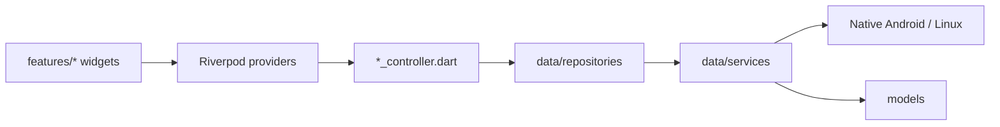

# Mawaqit

A calm, focused prayer-times app for Android — with adhan reminders that ring
like a real alarm clock — plus a Linux desktop target for development.

[](https://github.com/Abdogouhmad/mawaqit/actions/workflows/ci.yml)
[](LICENSE)
[](https://dart.dev)
[](https://github.com/Abdogouhmad/mawaqit/releases/latest)

<!-- TODO: add screenshots to docs/screenshots/ and reference them here. -->

## Features

- **Location-aware prayer times** via `adhan_dart` (city search, GPS, or manual
  coordinates) with a live countdown, the next-prayer progress row and the Hijri
  date alongside the Gregorian.
- **An adhan that rings like an alarm clock.** Prayer calls run on Android's
  exact-alarm engine: a foreground playback service plays the chosen tone once
  at alarm volume and a full-screen presenter takes over the lockscreen, whether
  the app is open, closed, or swiped away. Silence it with the on-screen button
  or either volume key.
- **Visible, fixable alarm reliability.** A one-time battery-optimisation ask on
  first install and after every update, plus a Permissions screen that lists each
  system access the adhan needs — Notifications, Alarms & reminders, Full-screen
  notifications, Do Not Disturb access, Unrestricted battery — with a live
  *Allowed* / *Fix* state. With DND access granted, a ringing adhan lifts silent
  mode for the call and restores your mode afterwards.
- **Two independent alert channels.** The short pre-prayer chime and the full
  adhan each have their own tone picker (built-in synthesised presets, bundled
  adhan recordings, device sounds, or Silent) and their own 3-second test button.
- **Home-screen widget.** A framed 2×2 Glance card with the location, next
  prayer, a countdown to the second and a five-dot day sequence. It keeps
  advancing while the app is closed and refreshes at every prayer rollover.
- **Decorated lockscreen reminder card** with a live countdown, a pulsing status
  dot, a synchronized progress bar, and **Mute this adhan** / **Dismiss**
  actions; the same mute can be toggled per-occurrence in-app.
- **In-app OTA updates.** Settings checks the release manifest, shows installed
  vs. latest with the "What's new" notes, and downloads, verifies (SHA-256) and
  installs the new APK.
- **English, Arabic and French.** Every string — including notification cards,
  the adhan screen and the widget — is translated; the layout mirrors to RTL in
  Arabic and a bundled Cairo face supplies the Arabic glyphs Manrope lacks.
- **Privacy-first.** No accounts, no tracking; all computation is on-device.

## Tech stack

| Concern | Choice |
| --- | --- |
| Framework / language | Flutter 3.47.x (stable) · Dart 3.13+ |
| State management | Riverpod 3 (`flutter_riverpod`) |
| Navigation | `go_router` |
| Storage | `shared_preferences` |
| Prayer calculation | `adhan_dart` |
| Notifications / alarms | `flutter_local_notifications` + native Android exact alarms |
| Background work | `workmanager` |
| Home-screen widget | `home_widget` (Jetpack Glance) |
| In-app updates | `ota_update`, `http` |
| Localization | `intl` + `flutter gen-l10n` (ARB files) |

## Supported platforms

- **Android** — the shipping target (min/target SDK from the Flutter toolchain).
- **Linux desktop** — supported for local development (`just run-linux`);
  background scheduling is Android-only and is safely skipped.

`ios/`, `web/`, `windows/` and `macos/` are not configured.

## Getting started

### Prerequisites

- Flutter **3.47.x** on the stable channel (Dart **3.13+**). Check with
  `flutter doctor -v`.
- For Android: Android Studio (Android SDK + platform tools) and a device or
  emulator.
- For the optional tooling below: [`just`](https://github.com/casey/just) and
  Python 3.

### Install and run

```sh
git clone git@github.com:Abdogouhmad/mawaqit.git
cd mawaqit
flutter pub get          # also generates lib/l10n/gen via gen-l10n
flutter run              # on a connected Android device/emulator
```

To develop on the desktop instead:

```sh
just run-linux           # flutter run -d linux
```

### Code generation

- **Localizations** are generated automatically by `flutter pub get` (the project
  sets `generate: true`); ARB sources live in `lib/l10n/`.
- **The home-screen widget** is code-generated. After editing
  `lib/src/home_widget/prayer_widget.dart`:

  ```sh
  just widget   # dart run home_widget_cli:home_widget generate -i lib/src/home_widget
  ```

- **Built-in adhan tones** are synthesised by `tool/gen_tones.py` into
  `assets/audio/` and the Android raw resources:

  ```sh
  just tones
  ```

## Project structure

```
lib/
  core/        design tokens, constants, theme, navigation, time/hijri helpers
  data/
    models/        AppSettings, PrayerTime, AlarmAccess, UpdateManifest…
    repositories/  settings, location, prayer-times (adhan_dart)
    services/      notification, background scheduler, alarm-access prompt,
                   muted-prayers store, tone preview, widget, OTA update
  features/
    home/          home screen, countdown controller, alarm-access gate
    settings/      settings + sub-screens (General, Notifications, Permissions),
                   update controller/screen
    times/         month prayer-times table (day rows, header, solar arc)
  shared/        reusable components and UI kit (buttons, cards, pills, sheets)
  src/home_widget/  home-widget DSL schema + its generated Glance helper
  l10n/          ARB sources, generated delegates, enum localization
  providers/     Riverpod providers wiring it together
  app.dart, main.dart
```

Native Android code lives under
`android/app/src/main/kotlin/com/freesoftware/mawaqit/` (`PrayerScheduler.kt`,
`AdhanScheduler.kt`, `AdhanPlaybackService.kt`, `AlarmAccess.kt`,
`PrayerWidgetHomeWidget.kt`, boot receivers, and so on), with the decorated
notification layouts under `android/app/src/main/res/layout/`.

## Architecture

Mawaqit uses a layered structure: **UI** (`features/*` widgets) reads state from
**Riverpod providers** (`providers/`, `*_controller.dart`), which call the
**data layer** (`data/repositories`, `data/services`). The scheduling math is
platform-agnostic — the same code drives Android's exact alarms and the Linux
timer fallback — so it is unit-testable without a device. Native Android only
owns what it must: alarm scheduling, playback and the widget.



## Building for release

Android (signed release builds are produced by `build.sh` / the release
workflow):

```sh
# Signed split-per-ABI + universal APKs, staged and verified under dist/
./build.sh

# Or the plain Flutter commands:
flutter build apk --release --split-per-abi
flutter build appbundle --release --obfuscate --split-debug-info=build/symbols
```

Release shrinking (`isMinifyEnabled` + `isShrinkResources` with the project's
`proguard-rules.pro`) is already enabled. `build.sh --release-notes` extracts the
matching `CHANGELOG.md` section for the GitHub release; `update_manifest.json` is
rewritten by the release workflow, never by hand.

## Testing

```sh
flutter analyze                       # must stay clean (lint rules in analysis_options.yaml)
dart format --output=none --set-exit-if-changed lib test
flutter test                          # unit + widget tests
flutter test --coverage               # writes coverage/lcov.info
```

## Contributing

Contributions are welcome — see [CONTRIBUTING.md](CONTRIBUTING.md) for the
workflow, conventions and PR checklist. Bug reports and feature requests use the
[issue templates](.github/ISSUE_TEMPLATE). Vulnerabilities: see
[SECURITY.md](SECURITY.md).

## License

Licensed under the [Apache License 2.0](LICENSE).

## Acknowledgements

Built on [Flutter](https://flutter.dev), with prayer times from
[`adhan_dart`](https://pub.dev/packages/adhan_dart), the Hijri calendar from
[`hijri`](https://pub.dev/packages/hijri), the home-screen widget via
[`home_widget`](https://pub.dev/packages/home_widget), and the Manrope and Cairo
typefaces.
